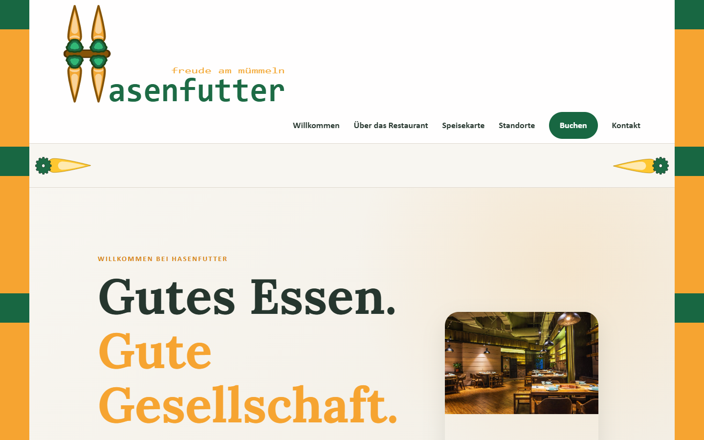
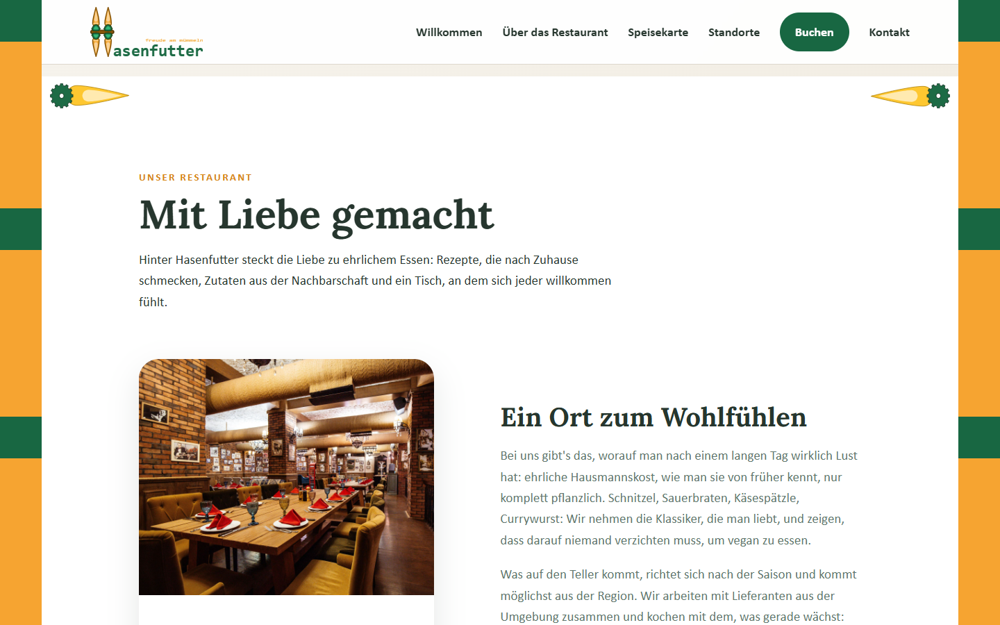
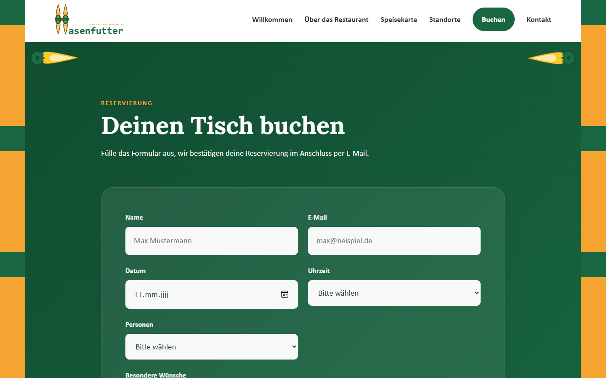
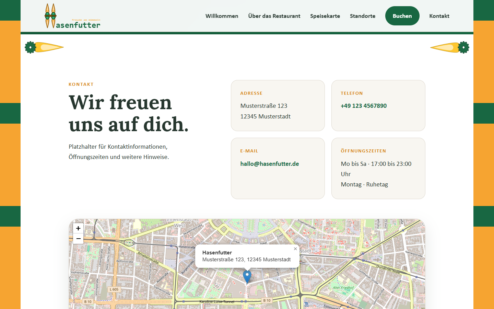
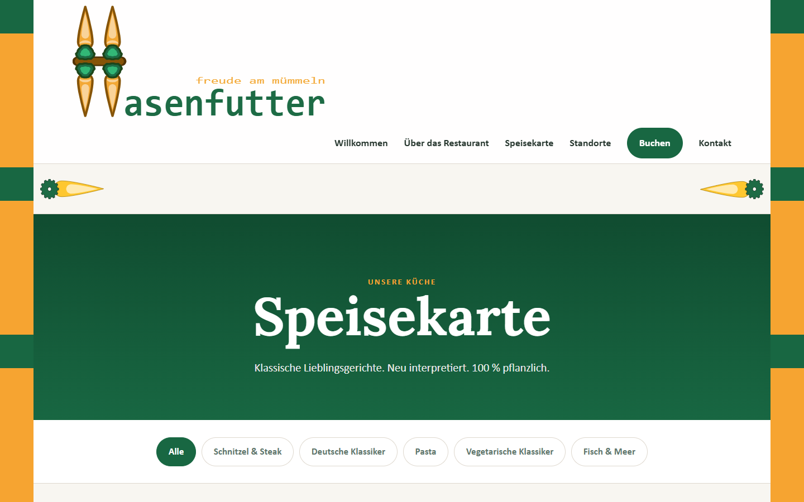
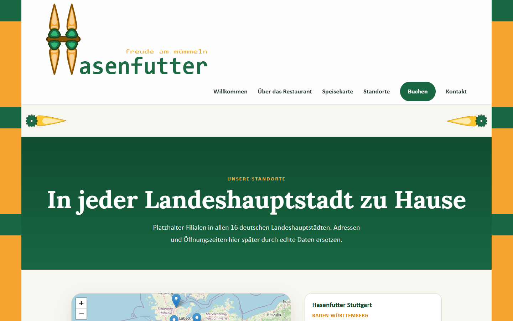
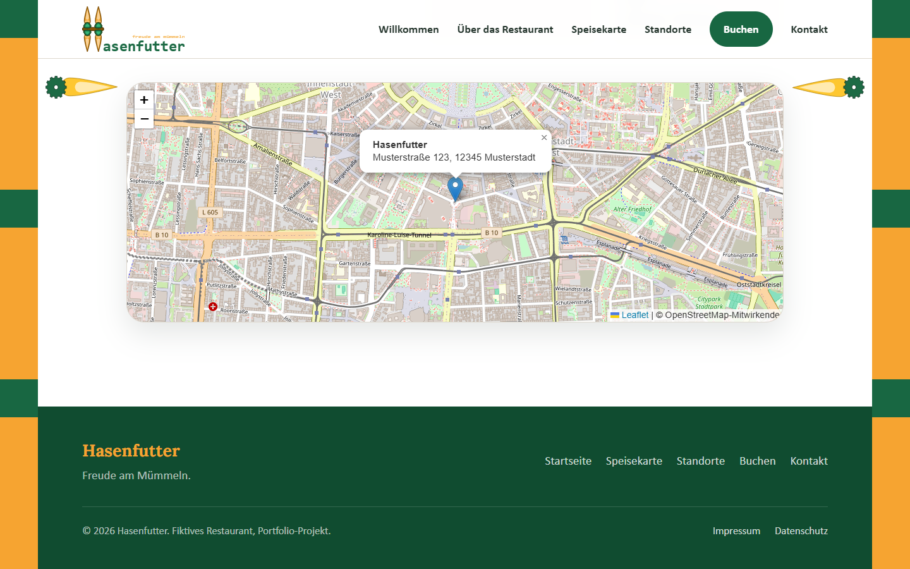
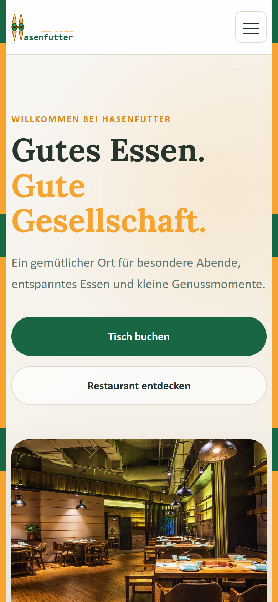

# Hasenfutter: Freude am Mümmeln


Fiktive vegane Restaurant-Website mit Tischreservierung. Portfolio-Projekt.
Klassische Hausmannskost, komplett pflanzlich, mit saisonalen Zutaten und
regionalen Lieferanten.

---

## Screenshots

| | |
|---|---|
|  |  |
| **Startseite** mit großem Header | **Über das Restaurant**, Header geschrumpft, Möhren im Seitenrand |
|  |  |
| **Reservierungsformular** | **Kontakt** mit Karte |
|  |  |
| **Speisekarte** mit Kategorie-Filter | **Standorte** mit interaktiver Karte |
|  |  |
| **Footer** mit Impressum und Datenschutz | **Mobile Ansicht** mit Hamburger-Menü |

## Features

- **Startseite** mit Hero-Bereich, Abschnitt "Über das Restaurant" (inklusive
  drei Bildkarten zu Küche, Ambiente und besonderen Momenten),
  Reservierungsformular und Kontaktbereich
- **Speisekarte** als eigene Seite mit Kategorie-Filter (Schnitzel & Steak,
  Deutsche Klassiker, Pasta, Vegetarische Klassiker, Fisch & Meer)
- **Standorte-Seite** mit interaktiver Karte (Leaflet und OpenStreetMap) und
  Filialen in allen 16 deutschen Landeshauptstädten
- **Kontaktbereich** mit Adresse, Telefon, E-Mail, Öffnungszeiten und
  eingebetteter Karte
- **Reservierungsformular** mit Client-seitiger Validierung (Pflichtfelder,
  E-Mail-Format, kein Datum in der Vergangenheit) und Anbindung an ein
  Django-Backend. Das Backend prüft Datum, Uhrzeit und Personenzahl noch
  einmal und zeigt Fehler direkt am jeweiligen Feld an.
- **Impressum und Datenschutzerklärung** als eigene Seiten, verlinkt im Footer.
  Die Texte sind Platzhalter, die Seite ist ein fiktives Portfolio-Projekt.
- **Datenschutzfreundlich umgesetzt**: Schriftart lokal eingebunden (keine
  Verbindung zu Google Fonts), keine Cookies, kein Tracking.
- **Eigenes Logo** mit integriertem Schriftzug, zusätzlich als Favicon
- **Dekorative Elemente** im Möhren-Stil: zwei Möhren, die beim Scrollen im
  Seitenrand direkt unter dem Header mitlaufen (ohne den Text zu überdecken),
  sowie ein durchgehender Randstreifen links und rechts
- **Schrumpfender Header**: Das große Logo wird beim Scrollen kleiner, damit
  mehr Platz für den Inhalt bleibt
- **Eigenes Farbsystem** auf HSL-Basis, zentral in CSS-Custom-Properties
  gepflegt
- **Fluide Schriftgröße**, die mit der Bildschirmbreite mitwächst
  (16px bis 19px), damit der Text auch auf großen Monitoren gut lesbar bleibt
- **Responsive Navigation**: Linknamen brechen nie über zwei Zeilen um, bei
  wenig Platz rutschen ganze Links in die nächste Zeile, auf dem Handy gibt
  es ein Hamburger-Menü

## Tech-Stack

**Frontend**
- Vue 3 (Composition API, `<script setup>`)
- Vite als Build-Tool
- Vue Router für Speisekarte und Standorte als eigene Routen
- Leaflet für die interaktiven Karten
- Lora für Überschriften, lokal eingebunden über `@fontsource/lora`

**Backend**
- Django und Django REST Framework für die Reservierungs-API
- SQLite als Datenbank
- django-cors-headers für die Verbindung zum Vite-Dev-Server
- python-decouple für Konfiguration über `.env`

## Projektstruktur

```
docs/
  screenshots/                    Bilder für dieses README

hasenfutter-vue/
  index.html
  .env.example                    VITE_API_URL
  public/
    favicon.ico
    logo.svg                      Logo als Favicon
  src/
    main.js                       Einstiegspunkt, Router und Schriften
    App.vue                       Header, Trenner, router-view, Footer, Randstreifen
    router/
      index.js                    Routen: / , /speisekarte , /standorte ,
                                  /impressum , /datenschutz
    style/
      variables.css               Farbpalette und Design-Tokens (HSL)
      base.css                    Reset, fluide Schriftgröße, Typografie, Buttons
    assets/
      logo.svg                    Logo mit Schriftzug
      carrot-divider.svg          Möhre für den Header-Trenner
      images/                     Fotos für Hero, Restaurant und Bildkarten
    components/
      TheHeader.vue               Logo (schrumpft beim Scrollen), Navigation, mobiles Menü
      HeaderDivider.vue           Zwei Möhren, die im Seitenrand mitlaufen
      TheFooter.vue               Links, Copyright, Impressum und Datenschutz
      HeroSection.vue             Willkommen
      AboutSection.vue            Über das Restaurant
      BookingSection.vue          Buchen, Formular mit Validierung
      ContactSection.vue          Kontakt mit Karte
    views/
      HomeView.vue                Bündelt Hero, About, Booking und Contact
      MenuView.vue                Speisekarte mit Kategorie-Filter
      LocationsView.vue           Standorte-Karte und Filialliste
      LegalView.vue               Impressum und Datenschutzerklärung

hasenfutter-backend/              Separates Django-Projekt
  .env.example                    SECRET_KEY, DEBUG, ALLOWED_HOSTS, CORS_ALLOWED_ORIGINS
  requirements.txt
  config/
    settings.py
    urls.py
  reservations/
    models.py
    serializers.py                Validierung (Datum, Uhrzeit, Personenzahl)
    views.py
    urls.py
    admin.py
    migrations/
    tests.py                      API-Tests
```

## Setup

### Frontend

```bash
cd hasenfutter-vue
npm install
npm run dev
```

Läuft standardmäßig unter `http://localhost:5173`.

### Backend

```bash
cd hasenfutter-backend
python -m venv venv
source venv/bin/activate      # Windows: venv\Scripts\activate

pip install -r requirements.txt
cp .env.example .env         # SECRET_KEY anpassen

python manage.py migrate
python manage.py createsuperuser
python manage.py runserver
```

Läuft standardmäßig unter `http://localhost:8000`. Das Admin-Interface ist
unter `http://localhost:8000/admin/` erreichbar.

Tests: `python manage.py test`. Die API-URL im Frontend lässt sich über
`VITE_API_URL` setzen (siehe `hasenfutter-vue/.env.example`).

Für die Reservierungsfunktion müssen Frontend und Backend gleichzeitig laufen.

### API

`POST /api/reservierungen/` legt eine Reservierung an.

```json
{
  "name": "Max Mustermann",
  "email": "max@beispiel.de",
  "date": "2026-12-24",
  "time": "19:00",
  "guests": "2 Personen",
  "message": ""
}
```

Antwort `201` mit dem gespeicherten Datensatz, bei ungültigen Angaben `400` mit
Fehlermeldungen pro Feld. Erlaubte Uhrzeiten sind 17:30 bis 20:30 im
30-Minuten-Takt, Daten in der Vergangenheit werden abgelehnt. Anfragen pro
Anonym-Nutzer sind auf 30 pro Stunde begrenzt.

## Farbpalette

Alle Farben liegen als HSL-Custom-Properties in `src/style/variables.css`:

| Rolle | Variable | Wert |
|---|---|---|
| Primär (Waldgrün) | `--color-forest` | `hsl(152, 62%, 25%)` |
| Primär dunkel | `--color-forest-dark` | `hsl(152, 65%, 18%)` |
| Primär hell | `--color-forest-light` | `hsl(152, 42%, 42%)` |
| Akzent (Honiggold) | `--color-honey` | `hsl(35, 92%, 58%)` |
| Akzent dunkel | `--color-honey-dark` | `hsl(35, 80%, 47%)` |
| Akzent hell | `--color-honey-light` | `hsl(37, 100%, 91%)` |
| Hintergrund (Creme) | `--color-cream` | `hsl(40, 33%, 96%)` |
| Fläche (Weiß) | `--color-white` | `hsl(0, 0%, 100%)` |
| Fläche warm (Leinen) | `--color-linen` | `hsl(39, 38%, 92%)` |
| Text (Tinte) | `--color-ink` | `hsl(152, 18%, 18%)` |
| Text sanft | `--color-ink-soft` | `hsl(152, 10%, 42%)` |
| Linien und Rahmen | `--color-border` | `hsl(38, 20%, 84%)` |

## Typografie

- Überschriften: Lora (lokal eingebunden), Fallback Georgia
- Fließtext: Gill Sans, Fallback Calibri und Trebuchet MS
- Die Root-Schriftgröße skaliert fluide zwischen 16px und 19px
